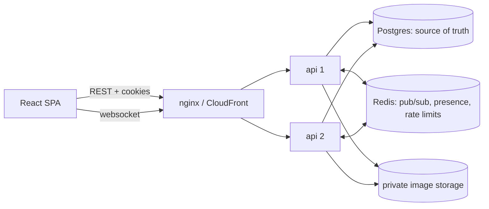

# CoopSwap

Sublets for students going on co-op. If you're leaving Boston for six months
in Seattle, list your room; if you're coming to Boston, find one from someone
who's leaving. Search by city, dates and budget, message the other student,
send a booking request, and the owner approves one.

Built as a full stack portfolio project with the boring-but-hard parts done
properly: bookings that can't double book under concurrency, durable chat
over websockets across multiple api instances, a transactional outbox for
notifications, and tests that actually race things.

> CoopSwap doesn't verify identities, leases or listings, doesn't take
> payments, and isn't affiliated with Northeastern. A booking here is an
> agreement to move forward, not a lease.

## Screenshots

Not captured yet: the app hasn't been run end to end on my machine since the
UI was finished (local Docker ran out of disk). To grab them:
`docker compose --profile app up -d --build`, `pnpm db:seed`, open
http://localhost:8080. They'll go in `docs/screenshots/`.

## What's in it

* **Listings**: multi-step create form with address autocomplete, photo upload
  (EXIF/GPS stripped), search by city / map viewport / dates / price / room
  type / amenities / text, keyset pagination, favorites. Public pins are fuzzed
  to ~400m; the exact address is shown only after an approved stay.
* **Bookings**: request → approve / reject / cancel / expire, enforced by a
  Postgres exclusion constraint, idempotency keys on every retryable POST,
  auto-reject of overlapping requests on approval.
* **Messaging**: one conversation per listing per pair, live delivery over
  Socket.IO + Redis, typing, presence, delivered/seen, unread counts, history
  paging and catch-up after reconnects.
* **Notifications**: in-app (live + persisted, collapsing per conversation)
  and email, delivered from a transactional outbox.
* **Accounts**: email/password with argon2id, server side sessions, email
  verification, separate university email linking, password reset, profile,
  settings, account deletion (anonymising).
* **Analytics**: anonymous events (no user id, no IP, daily-rotating session
  hash) and an admin page with search → request conversion.
* **Ops**: OpenTelemetry traces, Prometheus metrics + alerts, Grafana
  dashboard, structured logs with request/trace ids, Docker images, compose
  profiles, Codespaces devcontainer, GitHub Actions CI, Terraform for AWS,
  k6 load tests.

## Architecture



pnpm monorepo:

```
apps/api           express 5 api, socket.io, jobs, outbox relay
apps/web           react 19 + vite + tailwind 4 spa
packages/shared    zod schemas, booking state machine, date helpers, socket types
database/          sql migrations
monitoring/        prometheus, alerts, grafana, otel collector
infrastructure/    terraform (aws), not applied
tests/e2e          playwright
tests/load         k6
docs/              design notes
```

More in [docs/architecture.md](docs/architecture.md), including why there's
no PostGIS, no queue service, no auth provider and no Kubernetes.

## Key technical problems

**Double booking.** Only `approved` blocks dates. An
`EXCLUDE USING gist (listing_id WITH =, stay WITH &&) WHERE status = 'approved'`
constraint makes overlapping approvals impossible no matter how requests race.
Approvals lock the listing row first so they queue instead of deadlocking on
each other's auto-rejects. Idempotency keys are written in the same
transaction as the work, so concurrent retries replay rather than duplicate.
Details and the test matrix: [docs/bookings.md](docs/bookings.md).

**Chat across instances.** Messages get a gapless per-conversation seq from a
row-locked counter, are stored before anything is pushed, and dedupe on a
client id. Pushes go through the Socket.IO Redis adapter and are best effort;
clients dedupe by id, sort by seq, refetch on gaps. Not exactly-once, and the
docs say so: [docs/realtime.md](docs/realtime.md).

**Side effects that don't break bookings.** Notifications and emails are rows
in an outbox written inside the booking/message transaction. A relay on every
instance leases rows with `SKIP LOCKED`, does the push/email, retries with
backoff. SMTP being down never rolls back a booking.

**Privacy by default.** Fuzzed coordinates, EXIF stripping, signed URLs for
private images, no ids in metrics labels, no query strings or SQL params in
logs/traces, analytics without user ids.

## Stack

| | |
| --- | --- |
| web | React 19, TypeScript 6, Vite 8, Tailwind 4, TanStack Query 5, React Router 7, React Hook Form + zod 4, MapLibre (OpenFreeMap tiles), socket.io-client |
| api | Node 22, Express 5, Drizzle ORM + `pg`, ioredis, Socket.IO 4 + Redis adapter, argon2, sharp, pino, prom-client, OpenTelemetry |
| data | PostgreSQL 17 (btree_gist, citext), Redis 7 |
| tests | Vitest 4, React Testing Library, Supertest, socket.io-client, Playwright, k6 |
| infra | Docker, Compose, GitHub Actions, Terraform (AWS ECS Fargate, RDS, ElastiCache, S3, CloudFront) |

TypeScript is pinned to 6.0 because typescript-eslint doesn't support 7 yet.
jsdom is pinned to 26 because 27+ needs Node ≥ 22.22.

## Running it

Needs Node 22+, pnpm 10 (`corepack enable`), Docker.

```bash
pnpm install
cp .env.example apps/api/.env
docker compose up -d          # postgres :5440, redis :6380, mailpit :8025
pnpm db:migrate
pnpm db:seed                  # optional demo data, password coopswap-demo-password
pnpm dev                      # api :4000, web :5173
```

Emails (verification, reset) show up in Mailpit at http://localhost:8025. In
dev without `SMTP_URL` they're printed to the api log instead.

The whole thing in containers (two api replicas behind nginx), plus
monitoring:

```bash
docker compose --profile app --profile observability up -d --build
# app http://localhost:8080  grafana :3001  prometheus :9090  jaeger :16686
```

Or open the repo in GitHub Codespaces; `.devcontainer/` brings up Postgres,
Redis and Mailpit next to the workspace and runs migrations.

### Auth config

No third party needed. `SESSION_SECRET` (32+ chars) signs csrf/file URLs and
salts analytics hashes. `UNIVERSITY_DOMAINS` (default
`northeastern.edu,husky.neu.edu`) decides which addresses count as university
emails. `SMTP_URL` for real email. `COOKIE_SECURE=false` only for plain-http
setups like the local compose stack.

### Database

Migrations are plain SQL in `database/migrations`, applied in order, forward
only, checksummed, under an advisory lock. `database/init` creates the
`coopswap_test` database the integration tests use (they refuse to run
against anything without "test" in the URL). Schema notes and ER diagram:
[docs/database.md](docs/database.md).

## Tests

```bash
pnpm lint && pnpm -r typecheck
pnpm --filter @coopswap/shared test          # state machine, dates, schemas, message merge
pnpm --filter @coopswap/api test:unit        # no database needed
pnpm --filter @coopswap/web test             # RTL component tests
pnpm --filter @coopswap/api test:integration # needs postgres + redis (docker compose up -d)
pnpm --filter @coopswap/e2e test             # needs built api/web + mailpit
```

Integration tests run against real Postgres and Redis, including the booking
concurrency suite and tests that boot **three separate api processes** and
race them. See the scenario table in [docs/bookings.md](docs/bookings.md).

### Where things stand (honest version)

| suite | count | last run |
| --- | --- | --- |
| shared unit | 24 | passing locally |
| api unit | 6 | passing locally |
| web component | 13 | passing locally |
| api integration: auth, listings, search, bookings, concurrency, multi-instance, messaging, realtime | 70 | passed locally earlier in development; code around them has changed since (notifications hooked into messaging/bookings), so CI is the source of truth |
| api integration: notifications/outbox, uploads, analytics, index usage | 27 | written, **not run yet**; my local Docker ran out of disk before they could be. First run is CI. |
| e2e (Playwright) | 8 | written, not run yet, CI only |

CI (`.github/workflows/ci.yml`) runs all of it on GitHub's runners with
Postgres, Redis and Mailpit service containers, builds both Docker images,
smoke tests the api image and scans both with Trivy.

## Benchmarks

Method: `tests/load/` has k6 scripts for search under a ramping arrival rate,
a booking approval race (exactly one winner per listing), and socket fan-out
latency with up to N listener/sender pairs. The `Load test` workflow brings
up the full compose stack on a GitHub runner (2 api replicas, nginx,
Postgres, Redis), seeds data, runs k6, and uploads raw summaries plus a
`/metrics` snapshot as an artifact.

Results: **none yet.** Nothing has been run, so there are no numbers here.
When there are, they'll be copied from `tests/load/results/<date>-<sha>/`
with the runner type noted. Everything there is simulated traffic from k6
virtual users on a shared CI machine, useful for before/after comparisons,
not a capacity claim.

## Deploying

`infrastructure/terraform` describes an AWS setup (CloudFront → S3 for the
web build and → ALB → Fargate for the api, RDS Postgres, ElastiCache Redis,
private S3 for images, OIDC role for GitHub). It hasn't been applied; doing
so costs money. The `Deploy` workflow builds and pushes the image, runs
migrations as a one-off task, rolls the service (with automatic rollback on
failed health checks) and publishes the web build. It's skipped until the
environment variables exist. Runbook, migration policy, rollback and
recovery: [docs/operations.md](docs/operations.md).

## Security and privacy

[docs/security.md](docs/security.md): object level auth, CSRF, upload
handling, rate limits, session handling, what we log, what we collect, and
what we don't verify.

## Known limitations

* No payments, no leases, no identity or listing verification, by design for v1.
* "Today" for booking rules is computed in America/New_York for every listing.
* Distance sorting uses planar degrees (fine within a city, not a real radius search).
* Email delivery is at least once (a crash between sending and marking the outbox row could resend).
* Socket pushes can be dropped; clients recover via REST, there's no server side resend.
* Geocoding uses the public Photon instance (fair use); heavy use would need a paid or self-hosted geocoder.
* No admin moderation tools beyond the analytics page.
* Listing photos in local dev live on disk under `apps/api/.data`.
