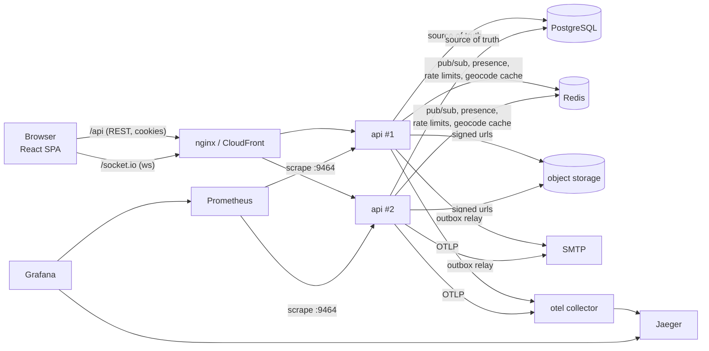

# Architecture

## Pieces

| piece | where | notes |
| --- | --- | --- |
| web | `apps/web` | React 19 + Vite + Tailwind 4, TanStack Query for server state, React Router 7, RHF + zod. MapLibre with OpenFreeMap tiles (no api key). |
| api | `apps/api` | Express 5. `modules/*` each own their routes + service. Services talk to Postgres through Drizzle (typed) or raw SQL where it matters (locks, ranges). |
| shared | `packages/shared` | zod schemas, the booking state machine, date-range helpers, socket event types. Used by both sides so validation and types can't drift. |
| database | `database/migrations` | hand written SQL, applied in order by `apps/api/src/db/migrate.ts` under an advisory lock. |
| realtime | `apps/api/src/realtime` | Socket.IO on the same http server, Redis adapter for fan-out between instances. |
| background | `apps/api/src/jobs`, `modules/notifications/outbox.ts` | timers in each api process. periodic jobs take a Postgres advisory lock so only one instance runs them; the outbox relay runs everywhere and splits work with `SKIP LOCKED`. |

## Request path

1. `request-id` puts an id in AsyncLocalStorage; every log line and the error body carry it.
2. global rate limit (Redis, falls back to in-memory if Redis is down).
3. `loadSession` turns the cookie into `req.user` (DB lookup, sliding expiry).
4. analytics intake (anonymous, sendBeacon, so it sits before csrf).
5. `csrf` (double-submit cookie + Origin check on non-GET).
6. module routers. Handlers parse input with the shared zod schemas and call a service.
7. errors become `{ error: { code, message, details, requestId } }`.

## Decisions worth explaining

**Own auth instead of a provider.** The spec suggested considering one. I went
with argon2id + server side sessions in Postgres because: it runs with zero
external accounts (clone and go), revoking sessions is a `DELETE`, and the
"university email" flow is custom anyway. The parts that are easy to get wrong
are covered: constant-ish time for unknown emails, tokens stored as sha256,
single-use via atomic `UPDATE ... RETURNING`, reset kills all sessions,
rate limits on every auth endpoint. Swapping in a provider later means
replacing `modules/auth` and `middleware/session.ts`, nothing else.

**SQL migrations, Drizzle for queries.** The constraints that matter
(exclusion constraints, generated columns, partial indexes, deferrable
uniques) are easier to read and review as SQL than as ORM config. Drizzle's
schema file only describes tables for typed queries.

**No PostGIS.** The official image has no arm64 build and the app only needs
"what's in this viewport" and "nearest first". Postgres' built in `point` with
a GiST index does both (`<@ box`, `<->` KNN). Distances are in degrees, which
is fine for ordering within a city; it'd be wrong for "within 5 miles" across
latitudes, which we don't offer.

**No job queue service.** The async work is small: expire requests, clean up
tokens, deliver notifications. Postgres already gives us locking
(`pg_try_advisory_lock`, `FOR UPDATE SKIP LOCKED`) and durability, so a
separate queue would be one more thing to run without adding guarantees.

**REST for writes, socket for pushes.** Sending a message is a POST with a
client-generated id. That gets csrf, rate limiting, validation, and
idempotent retries for free, and it means the socket can be best effort. See
[realtime.md](realtime.md).

**No Kubernetes.** Two stateless api containers behind a load balancer,
plus managed Postgres/Redis. ECS Fargate (see `infrastructure/`) does that
with one service definition.
