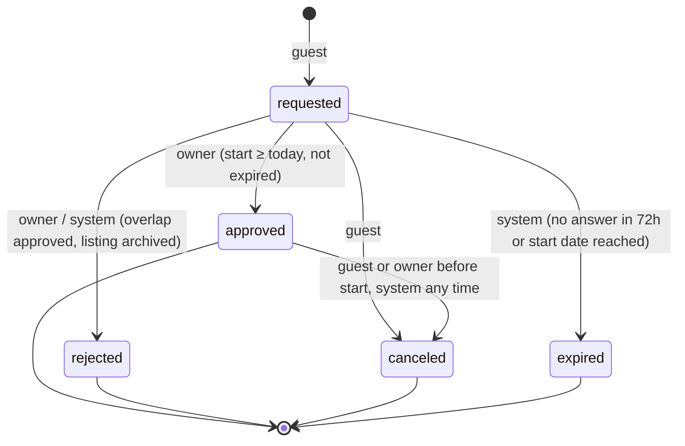

# Booking consistency

## The guarantee

> For a given listing, no two bookings in status `approved` share a night.

That's it. It's enforced by Postgres, not by application code:

```sql
constraint bookings_no_overlapping_approved
  exclude using gist (listing_id with =, stay with &&) where (status = 'approved')
```

`stay` is a generated `daterange(start_date, end_date, '[)')`. Because the
range is half open, the end date is the move-out day: a stay ending on the
15th and one starting on the 15th don't overlap.

Because the database checks this on every write, it holds regardless of how
many api instances there are, what order requests arrive in, retries, crashes
or bugs in the service layer. The test suite has a case that deliberately
skips all application locking and runs two raw `UPDATE`s concurrently to show
the second one fails with `23P01`.

## States



* **Only `approved` blocks dates.** Requests don't hold anything. An owner can
  have several overlapping requests and choose one; approving it rejects the
  overlapping ones in the same transaction with reason "dates were booked by
  someone else".
* The table lives in `packages/shared/src/bookings.ts` so the UI shows only
  the buttons that the server will accept.
* Repeating a transition that already happened (e.g. approve twice after a
  dropped connection) returns 200 with the current booking instead of an
  error.

## Locking order

Approve / cancel:

1. read the booking (no lock) to learn its listing
2. `SELECT ... FROM listings WHERE id = $1 FOR NO KEY UPDATE`
3. `SELECT ... FROM bookings WHERE id = $1 FOR UPDATE`, re-check state
4. update status → exclusion constraint checked here
5. auto-reject overlapping `requested` rows
6. history, notifications, outbox rows

Taking the listing lock first means two approvals for the same listing
queue instead of deadlocking (without it, A approves and tries to auto-reject
B while B approves and tries to auto-reject A). `FOR NO KEY UPDATE` doesn't
conflict with the `FOR KEY SHARE` that FK checks and booking creation take, so
new requests aren't blocked by an approval in progress. Listing edits take the
same lock and check that the new availability window still contains every
approved stay.

The lock is about behaving nicely under contention. The constraint is about
correctness. As a sanity check on the tests themselves, I removed both the
lock and the constraint on a scratch database once: three of the concurrency
tests failed (overlapping approvals got through, and the races deadlocked).
With either one in place they pass.

Deadlocks and serialization failures (`40P01`, `40001`) are retried up to
three times with jitter by `withTx`.

## Idempotency

`POST /bookings` and the transition endpoints accept `Idempotency-Key`.

* The key row `(user_id, scope, key, request_hash)` is inserted **at the
  start of the same transaction** that does the work.
* A concurrent duplicate blocks on that insert until the first commits, then
  sees the row and replays the stored response. If the first rolls back, the
  second proceeds as if it were first.
* Same key + different body → `422 idempotency_mismatch`.
* Only successful responses are stored. A failed attempt rolls back and takes
  its key with it, so retrying after a 409/400 re-runs the request.
* Stored response is `{ id }`; the route loads the booking after commit. So a
  replay returns the booking's *current* state, and we never build responses
  while holding row locks.
* Keys expire after 24h (cleanup job).

The web client makes one key per attempt (per set of inputs) and reuses it on
retry, so a double click or a timeout-then-retry can't create two requests.

## Expiry

`expires_at = min(now + 72h, start_date at midnight ET)`. Expiry is
housekeeping, not correctness: `approve` refuses an expired request even if
the sweeper hasn't run. The sweeper (every minute, one instance at a time)
uses `FOR UPDATE SKIP LOCKED` so it never waits on a booking someone is
acting on.

## Failure scenarios → tests

| scenario | test (apps/api/test) |
| --- | --- |
| 20 guests request the same dates, owner approves all at once | `bookings.concurrency` "20 guests ..." → exactly 1 approved, 19 rejected |
| random overlapping ranges approved concurrently | "random overlapping ranges ..." → no overlapping approved pairs |
| adjacent ranges | "adjacent ranges ..." → all approved |
| same idempotency key ×10 concurrently | "10 concurrent submits ..." → one booking, one non-replayed response |
| conflicting approvals from two owner sessions | "two owner sessions ..." ×5 rounds → one 200, one 409 |
| app forgets to lock | "the database rejects ..." → raw SQL race fails with 23P01 |
| error after the update, before commit | "an error after the update ..." → nothing persisted, key not stored |
| connection dies mid transaction (crash) | "a connection that dies ..." → locks released, other approval wins |
| client aborts request at various points then retries | "client gives up mid request ..." → exactly one booking per guest |
| 3 separate api processes | `bookings.multi-instance` → one winner, shared idempotency, sessions work everywhere |
| over HTTP, end to end | `tests/e2e/specs/booking.spec.ts` |
